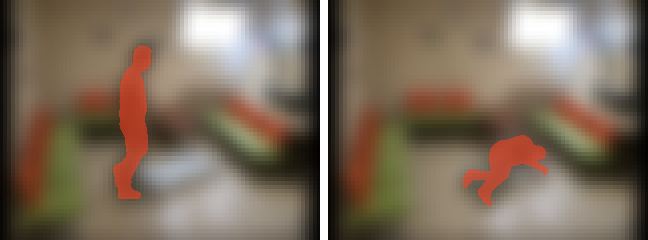
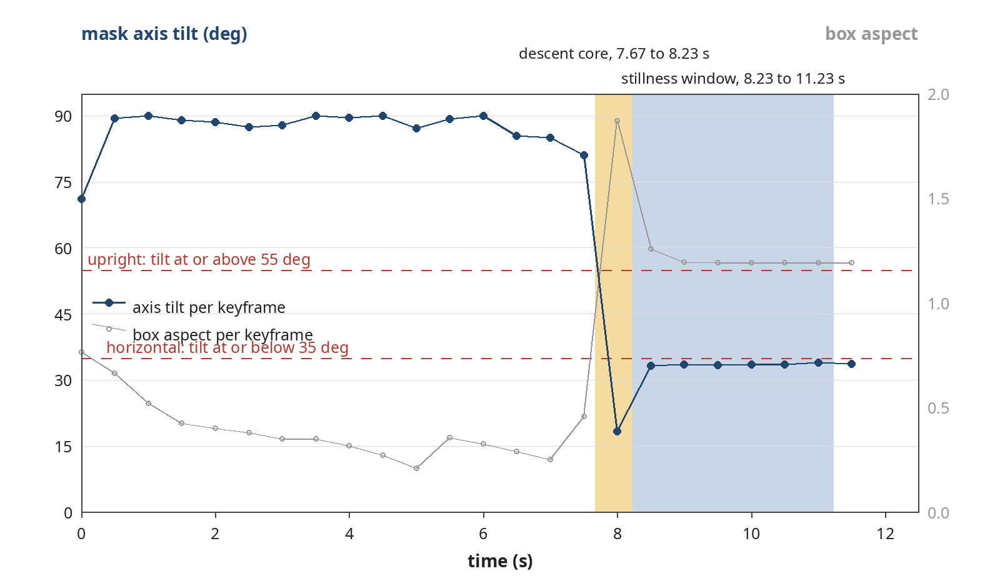
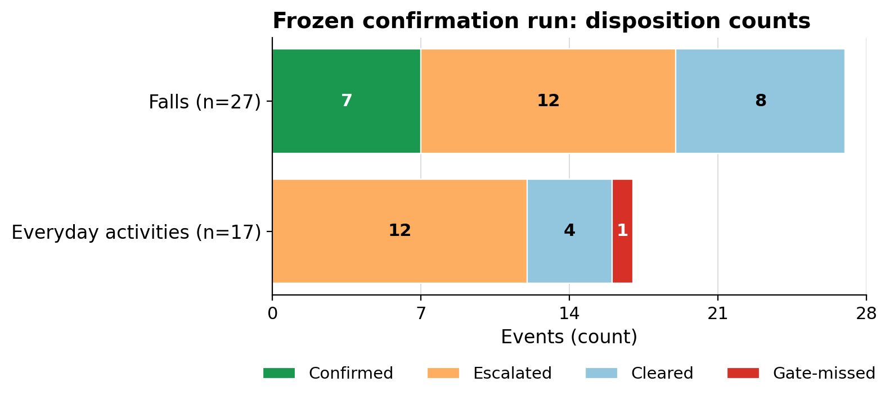

# Jaga

Jaga is a fall-event verifier I built for my parents in Indonesia. It checks moments selected as possible falls and decides whether each one should be confirmed, escalated to a person, or cleared.

This repository is my entry to the Meta Global AI Developer Hackathon.

**Status: research prototype.** Jaga has not been deployed or installed in a home, and nobody is being watched or protected by it yet. The performance numbers below are from public benchmark datasets. They are feasibility evidence. They do not show how Jaga would perform in a real home.

## Demo

[Watch the demo on YouTube](https://youtu.be/jybb4CCkP1s) (public).

The demo shows the alert ladder running in a demo harness.

## Why I built this

Both of my parents are usually at home together. The window I worry about is an ordinary one: one of them goes out and the other is home alone.

> "If one of them falls while the other is out, the risk is not only the fall. The risk is that nobody knows for hours."

Jaga means "to guard" in Indonesian.

In the Tinetti et al. (JAMA 1993) cohort, 148 of 313 non-injured fallers aged 72 and older (47%) reported being unable to get up without help after at least one fall.

The system would not prevent a fall. I am testing whether the evidence from a candidate fall is enough to route it sensibly: urgent, check now, or no immediate alert. The harm I am concerned about is time passing after a fall with nobody aware of it.

A first home version is costed as a plan at about $500 to install and about $100 a month to run. It would use two fixed cameras and the same rules on a small edge box, with shadow-mode calibration in the house before any alert reaches the family, and WhatsApp alerts ordered by who can reach the door first.

## What Jaga does

The shipped configuration has five stages:

| Stage | What happens |
| --- | --- |
| Motion gate | Frame differencing selects candidate moments. |
| SAM 3.1 segmentation | Segmentation runs on keyframes and produces posture evidence: mask overlays, axis tilt, aspect, and centroid. |
| Timing and features | Timing and features are measured locally, including descent duration and stillness. |
| Frozen rules | The rules decide whether an event is confirmed, escalated, or cleared. |
| Alert ladder | The disposition is mapped to an alert outcome. |



*The evidence the rules read, for one dev-set event (`le2i_coffee-room-01_video-02`, a staged fall from the public Le2i dataset; the performer is a dataset volunteer, not family). Left: keyframe at 7.0 s, before the descent; the mask's axis tilt reads 85°, upright. Right: keyframe at 9.0 s, after the descent; the same person's mask reads 33.5°, horizontal. Rendered by the shipped overlay code (`src/jaga/overlays.py`) from the SAM 3.1 output recorded for this event in the dev-set gate run. Full trace: [the worked example](results/sam_ablation_dev_2026-11-01/worked_example.md).*



*The same event, read over time: the mask's axis tilt (left axis) and bounding-box aspect (right axis) at each recorded keyframe, with the frozen rules' posture thresholds dashed, the descent core shaded first, and the stillness window that follows it shaded second. Every keyframe before the descent reads upright and every keyframe after it reads horizontal. Rendered by `scripts/render_worked_example_trace.py` from the per-clip record of the dev-set gate run; the lines join recorded points and add no values of their own. The performer is a dataset volunteer, not family.*

The timing, feature measurement, and rule decision run locally. On the API-backed path, the SAM 3.1 calls in the segmentation stage go through the Meta Model API. The rules read posture off the mask axis tilt: 55° or more counts as upright, 35° or less as horizontal. There is no pose estimation anywhere in the system; the honest label is person segmentation plus mask kinematics.

### Alert ladder

| Disposition | Alert ladder outcome |
| --- | --- |
| Confirmed | urgent |
| Escalated (uncertain) | check_now |
| Cleared (negative) | no_immediate_alert |
| System failure | floors at check_now |

The acknowledgement window is 900 seconds, with escalation if nobody responds. This ladder runs in a demo harness. It does not run in a home.

### Meta AI tooling

SAM 3.1 (Meta) supplies the posture evidence used by the rules in the shipped configuration.

Muse Spark (Meta) is not part of the shipped disposition path. I tested it as an adjudicator, it failed a pre-registered gate, and I removed it. The details are in the evaluation section below. The shipped system is rules-primary.

Muse Wonder (Meta) was used only during development, through the Meta Model API. It reviewed the evaluation write-ups and the demo film, and it designed the demo thumbnail. It produced no evaluation numbers.

### What Jaga keeps

By design, Jaga keeps no video archive. It keeps verdicts, traces, and measurements.

The evaluation harness keeps a local working cache on my machine: the keyframes it extracted and the SAM response streams it received, about 1.6 GB in a git-ignored directory that is never committed. The cache exists so that runs can be inspected, audited, and replayed; it is not footage kept for later viewing. Those records do not let anyone rewatch an event, so a disputed alert cannot be re-reviewed from footage. I regard that as a cost of the design.

## Evaluation

I froze the specification and thresholds before the confirmation run, and I adjusted nothing after that run. The benchmark numbers below can be checked against the result files and run records in this repository.

### The Muse Spark gate failed

I tested Muse Spark as an adjudicator under a pre-registered gate. It failed.

The gate's criteria, fixed in advance on the dev split (215 clips, 191 events):

| Criterion | Required | Measured |
| --- | --- | --- |
| Safety veto: additional missed falls against the rules-only arm | 0 | 0, passed |
| False-alarm reduction, relative | at least 40% | 0.0% (4 to 4) |
| False-alarm reduction, absolute | at least 3 | 0 |
| Usable verdicts | at least 95% | 141 of 142 (99.3%), passed |

On the dev split, false alarms went from 4 to 4 under the adjudicator, a reduction of 0.0% against a requirement of 40%. Its safety veto passed, but the overall gate did not.

For scale, both arms routed 71 of 99 dev falls to a human. Spark alone confirmed 49 of 99 falls with 7 false alarms, and a crude aspect-ratio baseline called 87 of 92 everyday activities a fall.

A post-hoc audit gave reason to doubt the labels behind the counted false alarms. Two of the source rooms ship no annotation files (in the Le2i archives, Coffee_room_01 ships 48 annotation files and Home_01 ships 30; the Lecture and Office archives ship none), and staged falls were found in all four clips counted as false alarms. That is a reason to question those labels. The result itself stands, and I have kept it as a FAIL. I removed the adjudicator from the disposition path, which is why the shipped system is rules-primary.

The verdict, in the two-level form this project uses for it: procedurally genuine FAIL; substantively indeterminate on the deciding criterion.

### Frozen confirmation run

The confirmation run was a single run with an unseen subject and room. Configuration hash: `6d7c03257b12ab00`.



| Outcome for falls | Count |
| --- | --- |
| Confirmed | 7 of 27 |
| Escalated | 12 of 27 |
| Cleared | 8 of 27 |
| Missed by the motion gate | 0 of 27 |

Confirmed and escalated together account for 19 of 27 falls routed to a human.

| Outcome for everyday activities | Count |
| --- | --- |
| Confirmed false alarms | 0 of 17 |
| Escalated | 12 of 17 |
| Cleared | 4 of 17 |
| Missed by the motion gate | 1 of 17 |

Across both groups:

- Falls routed to a human were 19 of 27 (95% CI 0.515 to 0.841).
- Motion-gate recall was 42 of 42 fall clips (95% CI 0.916 to 1.000).
- Definitive-alert precision was 7 of 7 (95% CI 0.646 to 1.000).
- Escalation was 24 of 44 events (54.5%, 95% CI 0.401 to 0.683).
- Confirmed false alarms were 0 in 0.18 h of ADL clips (exact Poisson 95% CI 0 to 20.5 per hour). The exposure is too short to present as a rate.
- SAM 3.1 processed 1,524 keyframes during the run; 1,489 were billed fresh calls, about $3.72 at $0.0025 per image.

### Per-dataset strata

I report the strata beside the overall line and never pool them away.

| Stratum | Falls routed to a human | Confirmed false alarms in everyday activities | Definitive-alert precision within the stratum |
| --- | --- | --- | --- |
| UP-Fall Subject 2 | 11 of 15 falls | 0 in 9 events | 5 of 5 |
| Le2i Coffee_room_02 | 8 of 12 falls | 0 in 8 events | 2 of 2 |

### How I read this run

The motion gate missed 0 of 27 falls, but the rules then cleared 8 of 27 falls. Under the alert ladder, those cleared falls would receive no immediate alert.

Escalation is doing much of the work. Everyday activities were escalated in 12 of 17 events, and the total above was 24 of 44 events. Those events are not counted as confirmed false alarms. They still route to check_now.

The intervals are wide. A precision of 7 of 7 still has a lower confidence bound of 0.646; the false-alarm count was 0 in only 0.18 h of ADL clips (exact Poisson 95% CI 0 to 20.5/h), an exposure too short to present as a rate. The denominators are small, and the results should be read that way.

### Limitations

The confirmation covers one UP-Fall subject and one Le2i room, which bounds generalisation rather than establishing it. Everyday-activity depth is thin (3 events per category per split), and stumble-and-recover is not a labelled category in either headline dataset. The 8 falls the rules cleared were never visually audited. Processing in the evaluation environment took a median of about 46 seconds per clip; this is an offline evaluation prototype.

### Sealed replication

A replication set (UP-Fall Subjects 3 to 5) was assembled and has never been inspected. I will run it once after the hackathon final, and I will publish the outcome whatever it is.

### Post-hoc diagnostic on SAM evidence

In a post-hoc development diagnostic, removing the SAM evidence took confirmed falls from 26 of 99 to 0 of 99.

I treat this as separate from the frozen confirmation run: in that diagnostic, the confirmed decisions depended on the SAM evidence. It is not a second confirmation result.

The regression suite passes 77 of 77 checks.

## Try it

This quickstart is for Python 3.12. The install step is one-time and needs network.

```bash
git clone https://github.com/adeyura/jaga-fall-verifier
cd jaga-fall-verifier
python3 -m venv .venv && .venv/bin/pip install -r requirements.txt
PYTHONPATH=src .venv/bin/python examples/run_example.py
```

The example then runs fully offline in about two seconds, or about two minutes end to end including install. It runs the downstream pipeline stages live on one real scored clip whose SAM output is pinned under `examples/`. The frozen rules return `fall_candidate` for a staged UP-Fall fall, with alert tier `urgent`, and the replay verifies its own verdict against the recorded one. The expected output is at `examples/upfall_s1_a1t1_cam1/expected_output.txt`.

### With Meta Model API access

The pipeline takes its SAM transport as an injected callable (`src/jaga/sam_runner.py`), so it is not tied to one machine's credentials. The contract is small: a callable that takes (image_bytes, prompt) and returns the raw SAM response stream text, as `helper_transport` in that module does. On my machine the transport is the Meta Model API connector helper, and `scripts/smoke_up_fall_clip.py` is wired to that helper and to my machine's paths; read it as my entry point. It is not a turnkey script. With your own Meta Model API access, pass an equivalent callable to `SamRunner` instead.

Prerequisites, stated before the commands: Python 3.12, as above; ffmpeg and ffprobe on PATH, which the full-pipeline paths shell out to for frame extraction and clip assembly; and your own Meta Model API access. This repository documents no signup path, because that side of the contract is Meta's. The repository's code reads no credential itself: the transport is the injected callable, and its authentication is the callable's own business. Cost basis: SAM 3.1 is accounted at the published rate of $0.0025 per image processed (`SAM_IMAGE_USD` in `src/jaga/sam_runner.py`); the confirmation run's $3.72 is that rate over the 1,489 images the API billed for it. No runnable example transport ships with the repository.

```bash
python3 scripts/download_up_fall.py
python3 scripts/assemble_up_fall_clips.py
python3 scripts/smoke_up_fall_clip.py <clip.mp4> <clip_id>
```

UP-Fall arrives as per-trial PNG sequences: fetch with `scripts/download_up_fall.py`, then assemble clips with `scripts/assemble_up_fall_clips.py` (ffmpeg, native 18 fps). The full scored runs are `scripts/run_gate_d1_dev.py` and `scripts/run_confirmation.py`, driven by the frozen manifests in `results/`.

## Repository guide

| Path | What it contains |
| --- | --- |
| `SPEC.md` | The frozen specification. |
| `DECISIONS.md` | The decisions log. |
| `results/` | Result files and run records. Every public number traces to the run results files there; if a number anywhere disagrees with those files, the files win and the text is wrong. |
| `examples/` | The worked examples and the pinned example. |
| `tests/run_checks.py` | The regression suite, 77 checks. |
| `src/` | The implementation, under `src/jaga/`: motion_gate, sam_runner and sam_parse, features, timing, rules, traces and overlays, alerts, harness, and the frozen config. `adjudicator.py` is retained from the removed Spark experiment and is not in the shipped path. |
| `scripts/` | The run and evaluation scripts. |

## Data, limits, and licences

The benchmarks use two public datasets, with a third used for per-view diagnostics only:

- Le2i Fall Detection Dataset (Charfi et al., 2013; re-deposited at dataUBFC, DOI [10.25666/DATAUBFC-2024-04-09](https://doi.org/10.25666/DATAUBFC-2024-04-09)).
- UP-Fall (Martinez-Villasenor et al., Sensors 19(9) 1988, 2019, DOI [10.3390/s19091988](https://doi.org/10.3390/s19091988)).
- UR Fall (per-view diagnostics only, never pooled): Kwolek and Kępski, Computer Methods and Programs in Biomedicine 117(3), 2014, CC BY-NC-SA 4.0.

All dataset falls are staged by young actors in lab rooms. They are not recordings from a lived-in home, and they cannot tell me how Jaga would perform for my parents. That gap is the largest limit on the results above.

Code in this repository is Apache-2.0. The datasets are CC BY-NC-SA and remain under their own terms.

## What I am not claiming

- Jaga is not deployed, installed, or watching anyone.
- I make no medical claims. Jaga verifies fall-like events and alerts people. It does not diagnose, treat, or guarantee a response.
- The consent layer in the design materials is a labelled mock. It is designed and not implemented.

